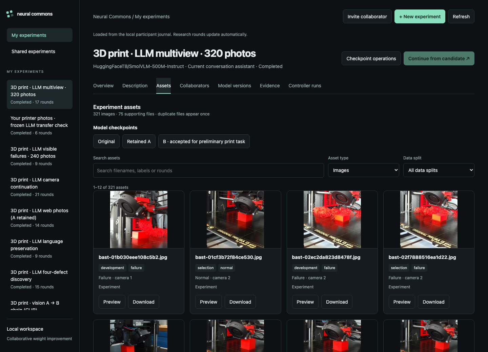
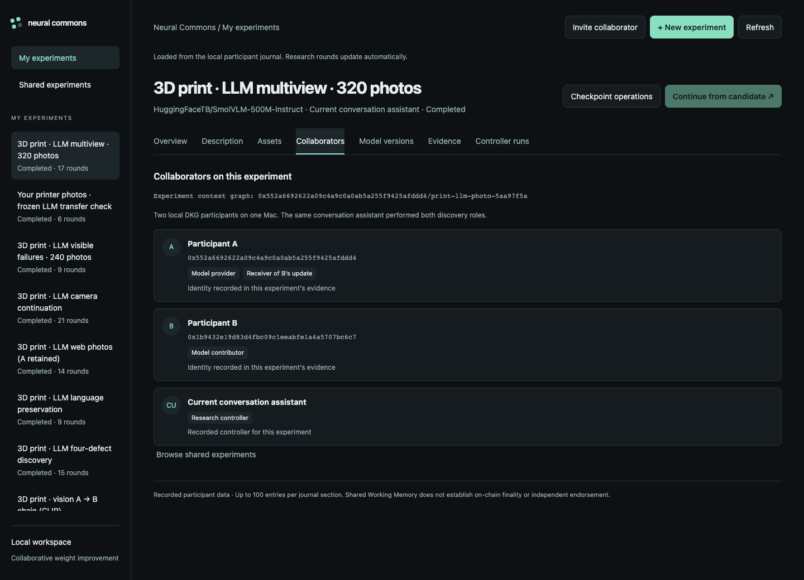
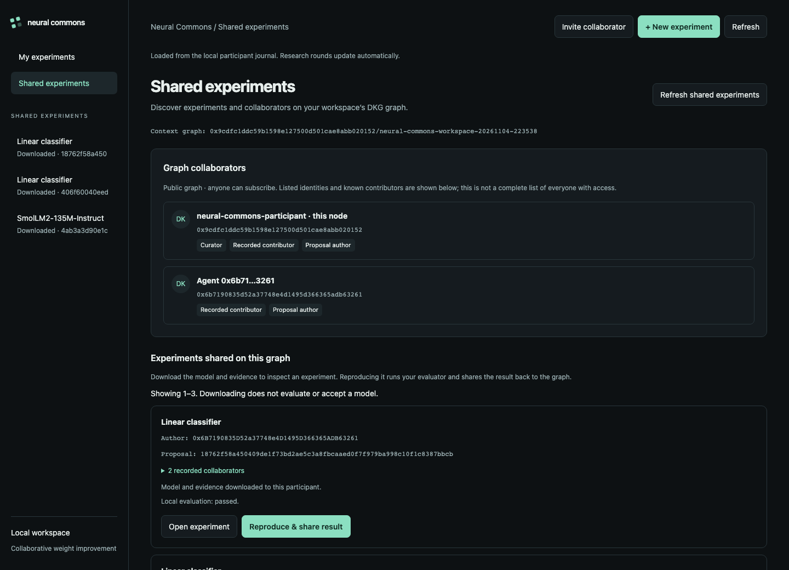

# Neural Commons

Collaborative neural-network weight changes through OriginTrail DKG. Rust provides an architecture-independent registry and patch engine over named tensors; operator-configured evaluators measure behavior. Graph Computer is not a dependency.

The project was inspired by [Rikiya Takehi's original X post and discussion](https://x.com/rikiyatakehi/status/2117313742891327994) and the research post [Sparks of Weight-Space Programming: LLMs can natively read & write neural network weights](https://rikiyat.github.io/blog/weight-space-programming/) by Rikiya Takehi, Jayden Teoh, Alex Zhang and Omar Khattab (MIT CSAIL, November 2, 2026). Their [released experiment logs](https://github.com/RikiyaT/lm_understand-logs) document the original work. Neural Commons builds on the idea of agents directly inspecting and editing weights, adding DKG-based sharing, reproducible evaluation and continuation by another controller.

V1 supports large and sharded Safetensors checkpoints, bounded-memory file processing, F32/F16/BF16 region patches and diffs, DKG-native artifact transfer, reproducible evaluator processes, durable local history, CLI operations and a local UI.

The local workspace organizes evaluations into experiments, with base/candidate
comparisons, checkpoint details, controller history and inspectable evidence.
The experiment list scrolls independently, keeping workspace navigation visible
while you browse long histories. It follows the selected section: **My experiments**
shows local runs, while **Shared experiments** lists proposals on the current DKG
catalogue page. Each section keeps its scroll position across navigation and updates.
**+ New experiment** starts from an imported model and a prepared task folder,
with a name, optional goal, controller selection and execution limits.
**Continue from candidate** starts a bounded background controller job from a
verified parent. Jobs retain their status and evidence across browser closure and
server restart, with cancellation, search resume and frozen-candidate import retry.

Conversation-led research is tracked in the same workspace from its first round,
before a final evaluation exists. The [research tracker](docs/RESEARCH-TRACKING.md)
records hypotheses, command progress, measurements, weight identities, decisions
and evidence in an append-only journal. The UI refreshes these rounds automatically,
including failed and rejected attempts. Use `nc research run` for numerical work;
standalone scripts do not register themselves automatically.

Each experiment has a **Description** view for its goal, method, data and limits,
and an **Assets** library for attached photos and evidence. Filter by data split,
preview images, download original files and inspect the linked model checkpoints.


[Watch the 48-second UI walkthrough](docs/media/workspace-walkthrough.mp4):
preview new-experiment setup, browse recorded rounds and photographs, and copy
the workspace graph's native DKG invite. Silent, with chapter labels.
Screens: [new experiment](docs/assets/workspace-create.png) ·
[recorded evaluation](docs/assets/workspace-results.png) ·
[DKG invitation](docs/assets/workspace-share-invite.png).

<details>
<summary>Browse photo assets, experiment collaborators and shared experiments</summary>

The **Assets** view shows the public print-study photographs with their recorded
split and source label. These screenshots were captured from the local app on
November 6, 2026.



**Collaborators** belongs to the selected experiment. This study records two local
DKG participants, A and B, with the same conversation assistant performing both
research roles.



**Shared experiments** is a separate workspace page for the configured DKG graph.
The graph's listed participants and recorded contributors appear above its
catalogue; they are distinct from an individual experiment's collaborators.



</details>

The [weight-space agent](docs/WEIGHT-AGENT.md) adds the central experimental loop:
an LLM controller reads and directly edits another pretrained language model's
weights, without gradients. It supports **Codex CLI with an existing login** and
the **OpenAI Responses API**. A separate evaluator tests the frozen candidate;
DKG carries the checkpoint, patch, controller transcript and reproduction evidence.
The [guarded AG News experiment](docs/AGNEWS-RESULTS.md) changed **2,268 BF16
weights** in an unmodified SmolLM2 checkpoint and improved fixed-prompt news
classification from **38.7% to 80.0% on 1,000 held-out examples**, while preserving
its sentiment guard. Two local DKG participants reproduced the identical output.
This is a task-specific gain, not a general capability claim. The earlier failed
edit and [SST-2 improvement with a regression](docs/SST2-RESULTS.md) remain recorded.
See the [reproduction workflow](docs/AGNEWS-WORKFLOW.md) and
[public evidence](docs/validation-agnews).

[Sequential continuation](docs/CONTINUATION-WORKFLOW.md) lets a different
controller receive that improved checkpoint through DKG, inspect the previous
agent's exact numerical diff and results, and propose a further patch. The child
uses the parent's exact checkpoint ID as its base, with fresh evaluation splits
and hash-bound ancestry evidence.
The [recorded second-controller run](docs/CONTINUATION-RESULTS.md) completed that
handoff and reproduced the exact ancestry through DKG. Its additional accuracy
gain passes the current **0.2 percentage-point** acceptance threshold. This
threshold was revised at the user's request after measurement; the original
1-point rejection and a separate policy reassessment are both preserved.

Requires Rust 1.93, Python 3.9+, Node 24, pnpm 10 and native build tools (Xcode Command Line Tools on macOS or a C/C++ toolchain on Linux).

```sh
git clone https://github.com/lupuszr/neural-commons.git
cd neural-commons
# Skip this clone if you already have a DKG checkout at this path.
git clone https://github.com/OriginTrail/dkg.git ~/projects/dkg-v9
python3 scripts/setup.py --dkg-repo ~/projects/dkg-v9
cargo run --locked --bin nc -- demo
```

The integration command starts two isolated DKG participants and a disposable local EVM, tests collaboration and recovery, and stops its services. It includes a trained classifier on real Iris data as well as labelled synthetic regression fixtures. No paid public-chain publication occurs.

To open the workspace for an initialized participant:

```sh
cargo build --locked --bin nc
target/debug/nc --home /absolute/path/to/participant serve --port 19500 \
  --controller-python /absolute/path/to/python
```

Open `http://127.0.0.1:19500`; the local workspace connects automatically.
`require_token` defaults to `false` (including existing configs where it is omitted).
To require the participant's UI access token, set `"require_token": true` in its
`config.json` and restart, or add `--require-token` to `nc serve`. The command-line
flag enables token enforcement even when the config is false. Remove the flag and
set the config to false to return to automatic local access.

Both modes listen only on `127.0.0.1`. Token-free API access accepts loopback Host
values and same-origin browser requests; foreign origins and cross-site requests
are rejected. Token-required mode keeps the existing bearer-token checks. DKG
credentials are separate and unchanged.
**Overview** compares scores from the same evaluation specification;
**Model versions** exposes checkpoint inspection and operations; **Evidence**
retains policies, reports and publication history; **Controller runs** tracks
background searches and their frozen candidates.

For controller execution, use a Python environment with
`requirements-weight-agent.txt`, an active configured DKG node, and either an
existing Codex login or `OPENAI_API_KEY` in the server environment. Continue
requires a recorded passing parent proposal and a prepared directory containing
fresh task splits and policies. Choose the backend, model and execution limits in
the UI. Final evaluation and DKG sharing remain explicit operations: a completed
search does not imply an accepted or published model. See the
[controller setup, API and recovery guide](docs/CONTINUATION-UI.md).

**Shared experiments** is a workspace page in the sidebar (or top navigation on mobile). It discovers proposals from the configured DKG context graph and shows its curator, listed participants and recorded contributors. Public graph access is not an exhaustive membership list. Download a model and its evidence, inspect it locally, then choose **Reproduce & share result** to evaluate and publish your report. Eligible proposals can be continued from the same view.

Each experiment has its own **Collaborators** tab, scoped to its linked proposal, evaluations and reviews, or explicitly recorded research participants. Its graph can differ from the workspace graph. Open the shared catalogue directly at `/#/shared`.

Use **Invite collaborator** to copy the workspace context graph’s native DKG invite code. Collaborators join through their own DKG node; approval and contribution permissions follow the graph’s existing policies.

In both experiment forms, users choose the editable weights: the whole model by default, or selected tensors. Task-file weight restrictions are replaced by these explicit choices. Goals, additional instructions and an optional edited-value budget are saved with the run; see the UI guide for enforcement and evaluation rules.

The UI displays the verdict stored in each evaluation report. The recorded second
controller's original failed gate therefore remains visible even though the
separate policy reassessment accepts it under the revised threshold.

- [V1 setup, commands, evaluator contract and limitations](docs/V1.md)
- [UI controller jobs, requirements, API and local validation](docs/CONTINUATION-UI.md)
- [V1 validation evidence](docs/V1-VALIDATION.md)
- [Accepted v1 scope](docs/V1-PLAN.md)
- [Original plan](PLAN.md) and [first-delivery evidence](docs/VALIDATION.md)

Setup uses a separate DKG checkout and a [small local compatibility patch](patches/dkg-opaque-source-read.patch) for reading opaque source artifacts. It preserves the original dirty checkout. The patch is not claimed to be merged upstream. Rust dependencies are pinned in Cargo.lock.

Licensed under [Apache-2.0](LICENSE).

## Real-photo weight discovery

Current research uses **SmolVLM-500M-Instruct**, a vision-language model, for a
binary question about visible 3D-print failure. The 320-photo study tracks the
original model, inherited A and a further edit at B, including changes to internal
language-model weights, final evaluation and exact checkpoint replay through two
local DKG nodes. Every attempt and decision is recorded in the
[research workspace](docs/RESEARCH-TRACKING.md), including rejected edits and later
lighting and source-transfer checks.

The recorded gain is preliminary and specific to this task. Source frames are
correlated, labels have not been independently confirmed by a human, and reliable
transfer across printers and photography styles is not established. A separate
diagnostic on the owner's photographs remains inconclusive for failure detection
and records apparent false alarms. The screenshots show local journal history;
they are not a substitute for a portable reproduction bundle.

The earlier [public experiment evidence](docs/validation-print-discovery/README.md)
covers internal **CLIP** weight edits and seven feedback-driven attempts. That
adaptive candidate was rejected after final evaluation and the earlier checkpoint
was retained. These exploratory runs remain available alongside the LLM work.

Use the [weight-discovery skill](.agents/skills/neural-commons-weight-discovery/SKILL.md) for agent-led experiments. The assistant makes the experimental decisions; scripts execute edits and measurements.
