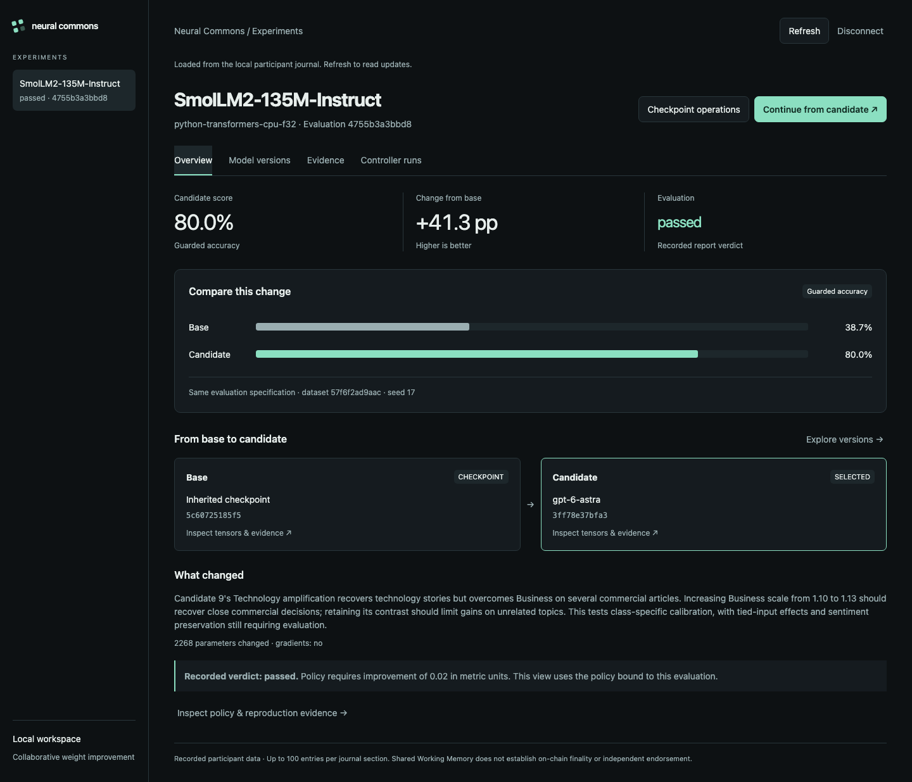

# Neural Commons

Collaborative neural-network weight changes through OriginTrail DKG. Rust provides an architecture-independent registry and patch engine over named tensors; operator-configured evaluators measure behavior. Graph Computer is not a dependency.

The project was inspired by [Rikiya Takehi's original X post and discussion](https://x.com/rikiyatakehi/status/2117313742891327994) and the research post [Sparks of Weight-Space Programming: LLMs can natively read & write neural network weights](https://rikiyat.github.io/blog/weight-space-programming/) by Rikiya Takehi, Jayden Teoh, Alex Zhang and Omar Khattab (MIT CSAIL, November 2, 2026). Their [released experiment logs](https://github.com/RikiyaT/lm_understand-logs) document the original work. Neural Commons builds on the idea of agents directly inspecting and editing weights, adding DKG-based sharing, reproducible evaluation and continuation by another controller.

V1 supports large and sharded Safetensors checkpoints, bounded-memory file processing, F32/F16/BF16 region patches and diffs, DKG-native artifact transfer, reproducible evaluator processes, durable local history, CLI operations and a local UI.

The local workspace organizes evaluations into experiments, with base/candidate
comparisons, checkpoint details, controller history and inspectable evidence.
**Continue from candidate** starts a bounded background controller job from a
verified parent. Jobs retain their status and evidence across browser closure and
server restart, with cancellation, search resume and frozen-candidate import retry.



The [weight-space agent](docs/WEIGHT-AGENT.md) adds the central experimental loop:
an LLM controller reads and directly edits another pretrained language model's
weights, without gradients. It supports **Codex CLI with an existing login** and
the **OpenAI Responses API**. A separate evaluator tests the frozen candidate;
DKG carries the checkpoint, patch, controller transcript and reproduction evidence.
The [guarded AG News experiment](docs/AGNEWS-RESULTS.md) changed **2,268 BF16
weights** in an unmodified SmolLM2 checkpoint and improved fixed-prompt news
classification from **38.7% to 80.0% on 1,000 held-out examples**, while preserving
its sentiment guard. Two local DKG participants reproduced the identical output.
This is a task-specific gain, not a general capability claim. The earlier failed
edit and [SST-2 improvement with a regression](docs/SST2-RESULTS.md) remain recorded.
See the [reproduction workflow](docs/AGNEWS-WORKFLOW.md) and
[public evidence](docs/validation-agnews).

[Sequential continuation](docs/CONTINUATION-WORKFLOW.md) lets a different
controller receive that improved checkpoint through DKG, inspect the previous
agent's exact numerical diff and results, and propose a further patch. The child
uses the parent's exact checkpoint ID as its base, with fresh evaluation splits
and hash-bound ancestry evidence.
The [recorded second-controller run](docs/CONTINUATION-RESULTS.md) completed that
handoff and reproduced the exact ancestry through DKG. Its additional accuracy
gain passes the current **0.2 percentage-point** acceptance threshold. This
threshold was revised at the user's request after measurement; the original
1-point rejection and a separate policy reassessment are both preserved.

Requires Rust 1.93, Python 3.9+, Node 24, pnpm 10 and native build tools (Xcode Command Line Tools on macOS or a C/C++ toolchain on Linux).

```sh
git clone https://github.com/lupuszr/neural-commons.git
cd neural-commons
# Skip this clone if you already have a DKG checkout at this path.
git clone https://github.com/OriginTrail/dkg.git ~/projects/dkg-v9
python3 scripts/setup.py --dkg-repo ~/projects/dkg-v9
cargo run --locked --bin nc -- demo
```

The integration command starts two isolated DKG participants and a disposable local EVM, tests collaboration and recovery, and stops its services. It includes a trained classifier on real Iris data as well as labelled synthetic regression fixtures. No paid public-chain publication occurs.

To open the workspace for an initialized participant:

```sh
cargo build --locked --bin nc
target/debug/nc --home /absolute/path/to/participant serve --port 19500 \
  --controller-python /absolute/path/to/python
```

Open `http://127.0.0.1:19500` and enter the participant's UI access token.
**Overview** compares scores from the same evaluation specification;
**Model versions** exposes checkpoint inspection and operations; **Evidence**
retains policies, reports and publication history; **Controller runs** tracks
background searches and their frozen candidates.

For controller execution, use a Python environment with
`requirements-weight-agent.txt`, an active configured DKG node, and either an
existing Codex login or `OPENAI_API_KEY` in the server environment. Continue
requires a recorded passing parent proposal and a prepared directory containing
fresh task splits and policies. Choose the backend, model and execution limits in
the UI. Final evaluation and DKG sharing remain explicit operations: a completed
search does not imply an accepted or published model. See the
[controller setup, API and recovery guide](docs/CONTINUATION-UI.md).

The UI displays the verdict stored in each evaluation report. The recorded second
controller's original failed gate therefore remains visible even though the
separate policy reassessment accepts it under the revised threshold.

- [V1 setup, commands, evaluator contract and limitations](docs/V1.md)
- [UI controller jobs, requirements, API and local validation](docs/CONTINUATION-UI.md)
- [V1 validation evidence](docs/V1-VALIDATION.md)
- [Accepted v1 scope](docs/V1-PLAN.md)
- [Original plan](PLAN.md) and [first-delivery evidence](docs/VALIDATION.md)

Setup uses a separate DKG checkout and a [small local compatibility patch](patches/dkg-opaque-source-read.patch) for reading opaque source artifacts. It preserves the original dirty checkout. The patch is not claimed to be merged upstream. Rust dependencies are pinned in Cargo.lock.

Licensed under [Apache-2.0](LICENSE).
